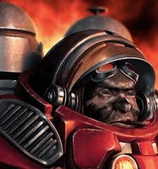

# HTML 태그 정리 (Day 1)

HTML(HyperText Markup Language)은 웹 페이지의 **구조와 의미**를 만드는 마크업 언어입니다.
태그는 `<태그명>내용</태그명>`처럼 **여는 태그 + 내용 + 닫는 태그**로 이루어지고,
`<hr>`, ``, `<input>`처럼 닫는 태그가 없는 **빈 태그(void element)** 도 있습니다.

---

## 1. 문서 구조 태그

| 태그 | 설명 |
| --- | --- |
| `<!DOCTYPE html>` | 이 문서가 HTML5 문서임을 브라우저에 알림 (맨 첫 줄) |
| `<html lang="ko">` | 문서 전체를 감싸는 최상위 태그. `lang`으로 문서 언어 지정 |
| `<head>` | 화면에 직접 보이지 않는 **문서 정보**(제목, 인코딩, CSS 연결 등)를 담는 영역 |
| `<meta charset="UTF-8">` | 문자 인코딩 지정. 없으면 한글이 깨질 수 있음 |
| `<title>` | 브라우저 탭에 표시되는 문서 제목 |
| `<body>` | 화면에 **실제로 보이는 내용**을 담는 영역 |

```html
<!DOCTYPE html>
<html lang="ko">
<head>
  <meta charset="UTF-8">
  <title>자기소개서</title>
</head>
<body>
  내용
</body>
</html>
```

---

## 2. 텍스트 태그

| 태그 | 설명 |
| --- | --- |
| `<h1>` ~ `<h6>` | 제목(Heading). `h1`이 가장 크고 중요, `h6`이 가장 작음. 페이지당 `h1`은 보통 1개 권장 |
| `<p>` | 문단(Paragraph). 위아래로 여백이 생김 |
| `<hr>` | 가로 구분선 (빈 태그) |
| `<br>` | 줄바꿈 (빈 태그) |

```html
<h1>Self Introduction.</h1>
<hr>
<p>안녕하세요, 강재우입니다.</p>
```

> 💡 `h1~h6`은 글자 크기를 키우려고 쓰는 것이 아니라 **제목의 위계(구조)** 를 나타내는 용도입니다. 크기는 CSS로 조절합니다.

---

## 3. 목록 태그

| 태그 | 설명 |
| --- | --- |
| `<ul>` | 순서 **없는** 목록 (Unordered List). 기본 모양은 점(●) |
| `<ol>` | 순서 **있는** 목록 (Ordered List). 기본 모양은 숫자(1, 2, 3) |
| `<li>` | 목록의 항목(List Item). `ul`/`ol` 안에서만 사용 |

### 자주 쓰는 속성

- `<ul style="list-style: square">` : 점 모양을 네모로 변경 (`disc`, `circle`, `square`)
- `<ol type="i">` : 번호 종류 변경 (`1`, `a`, `A`, `i`, `I`)

```html
<ul style="list-style: square">
  <li>이름: 강재우</li>
  <li>나이: 31살</li>
</ul>

<ol type="i">
  <li>취미: 독서</li>
  <li>좋아하는 음식: 제주 맛집</li>
</ol>
```

---

## 4. 표(Table) 태그

| 태그 | 설명 |
| --- | --- |
| `<table>` | 표 전체를 감싸는 태그 |
| `<thead>` | 표의 **머리글** 영역 |
| `<tbody>` | 표의 **본문** 영역 |
| `<tfoot>` | 표의 바닥글 영역 (합계 등) |
| `<tr>` | 표의 한 행(Table Row) |
| `<th>` | 머리글 셀(Table Header). 굵게, 가운데 정렬이 기본 |
| `<td>` | 일반 데이터 셀(Table Data) |

```html
<table border="1">
  <thead>
    <tr>
      <th>회사명</th>
      <th>직무</th>
      <th>기간</th>
    </tr>
  </thead>
  <tbody>
    <tr>
      <td>OZ코딩스쿨</td>
      <td>수강생</td>
      <td>2026~현재</td>
    </tr>
  </tbody>
</table>
```

- `border="1"` : 표 테두리 표시
- `colspan` / `rowspan` : 셀을 가로 / 세로로 합치기

---

## 5. 이미지와 링크 태그

### `` — 이미지 (빈 태그)

| 속성 | 설명 |
| --- | --- |
| `src` | 이미지 파일 경로 또는 URL (필수) |
| `alt` | 이미지가 안 뜰 때 / 스크린리더용 **대체 텍스트** (필수 권장) |
| `width`, `height` | 이미지 크기 |

```html

```

### `<a>` — 링크(Anchor)

| 속성 | 설명 |
| --- | --- |
| `href` | 이동할 주소 (필수) |
| `target="_blank"` | 새 탭에서 열기 |

```html
<a href="https://github.com">내 Repository 바로가기</a>
```

---

## 6. 폼(Form) 관련 태그

| 태그 | 설명 |
| --- | --- |
| `<form>` | 사용자 입력을 모아 서버로 보내는 영역. `action`(보낼 주소), `method`(GET/POST) 속성 사용 |
| `<label>` | 입력창의 설명 글자. `for` 값을 input의 `id`와 같게 하면 라벨 클릭 시 입력창에 포커스 |
| `<input>` | 사용자 입력창 (빈 태그). `type`에 따라 모양과 기능이 달라짐 |
| `<button>` | 클릭 버튼. 폼 안에서는 기본적으로 제출(submit) 동작 |

### `<input>`의 주요 type

| type | 설명 |
| --- | --- |
| `text` | 한 줄 텍스트 |
| `email` | 이메일 형식 검사 |
| `password` | 입력 내용이 가려짐 |
| `number` | 숫자만 입력 |
| `checkbox` | 다중 선택 체크박스 |
| `radio` | 하나만 선택하는 라디오 버튼 |
| `submit` | 제출 버튼 |

### 자주 쓰는 속성

- `placeholder` : 입력 전 보이는 안내 문구
- `id` / `name` : 입력창 식별자 (label 연결 / 서버 전송용)
- `required` : 필수 입력

```html
<form action="">
  <label for="emailInput">담당자 이메일: </label>
  <input id="emailInput" type="email" placeholder="email@example.com">
  <button>이력서 전송하기</button>
</form>
```

---

## 7. 자주 헷갈리는 포인트

1. **`<head>` vs `<body>`** : head는 문서 정보(안 보임), body는 화면에 보이는 내용
2. **`<ul>` vs `<ol>`** : 순서가 의미 있으면 `ol`, 아니면 `ul`
3. **`<th>` vs `<td>`** : 머리글 셀은 `th`, 데이터 셀은 `td`
4. **빈 태그** : `<hr>`, `<br>`, ``, `<input>` 은 닫는 태그가 없음
5. **`alt` 속성** : 접근성과 이미지 로딩 실패 대비를 위해 `img`에는 항상 작성
6. **`label`의 `for` ↔ `input`의 `id`** : 두 값이 같아야 연결됨

---

## 8. 오늘 만든 resume.html 구조 요약

```text
html
├─ head (meta, title)
└─ body
   ├─ h1 + hr         → Self Introduction
   ├─ img, p, a, ul   → 프로필 사진, 소개, 레포 링크, 기본 정보 목록
   ├─ h1 + hr + ol    → Hobby & Preference
   ├─ h1 + hr + table → Career & Work Experience
   └─ h1 + hr + form  → Send Cover Letter (label, input, button)
```
